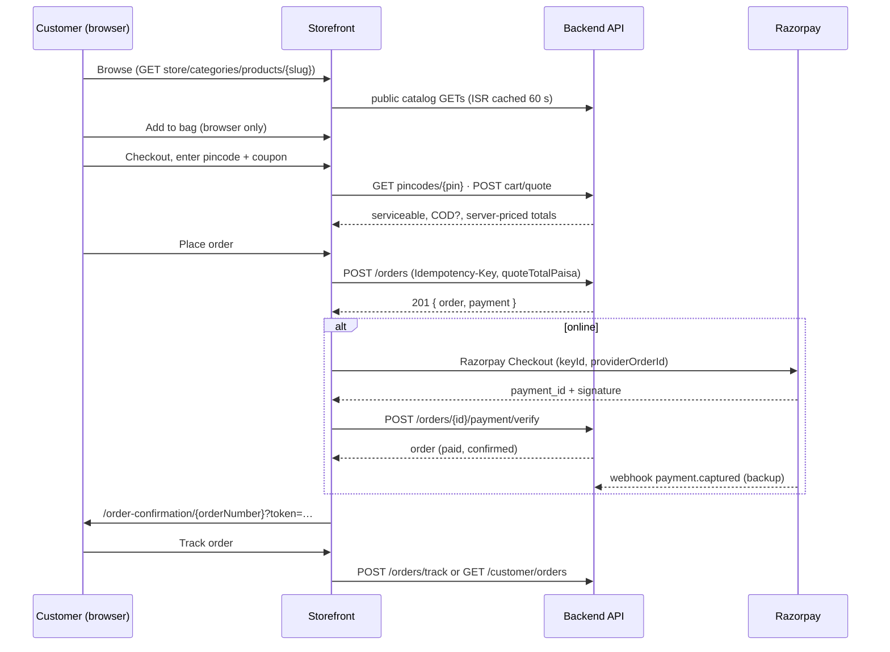

# Aarsi Apparel — API Specification (storefront ⇄ backend)

Base URL: `https://admin.aarsiapparel.com` (the storefront also proxies `/api/v1/*` and `/api/objects/*` on its own domain so the session cookie works without CORS).

* **Existing** = already in your Postman collection (`Aarsi-Apparel-Frontend`).
* **New** = needed to take an order from cart to an order object being returned, then payment, tracking, cancel and return. The storefront is already coded against these; set `NEXT_PUBLIC_COMMERCE_API=on` once they exist. Until then it uses the WhatsApp order hand-off.

## 1. Conventions
| | |
|---|---|
| Envelope | Success `{ "success": true, "data": … }` · Error `{ "success": false, "error": { "code", "message", "details?" } }` |
| Money | Integer **paisa** (₹1 = 100). Never floats. Currency `INR`. |
| Prices | Tax-inclusive ("Inclusive of all taxes"). `gstIncludedPaisa` is informational, calculated by the backend. |
| IDs | Opaque strings. `orderNumber` is the human-facing id (`AA-100234`). |
| Auth | Guest checkout allowed. Signed-in customers use the HttpOnly cookie `aarsi_customer_session`. Guests get a `trackingToken` on order creation. |
| Dates | ISO-8601 UTC. |
| Idempotency | `POST /orders` requires header `Idempotency-Key` (UUID). Same key ⇒ same order, never a duplicate. |
| Phone | 10-digit Indian mobile, digits only (`^[6-9]\d{9}$`). Storefront strips `+91`/spaces. |
| Pincode | `^[1-9]\d{5}$` |

## 1b. Language (English / Hindi)
The storefront is bilingual. On every request it sends **`Accept-Language: hi`** (or `en`) and, on public `GET /api/v1/public/*` endpoints, **`?lang=hi`** (omitted for English).
* Return localized text for: product `name`, `shortDescription`, `description`, `care`, `fabric`; category `name`; collection `name`, `description`; blog `title`, `excerpt`, `content`; order `timeline[].label`; and error `message`.
* If a translation is missing, return the English text. Never return empty strings. Response shape and field names do not change.
* IDs, slugs, SKUs, prices and enum values (`status`, `paymentStatus`) are language-independent.
* Suggested admin storage: a `translations: { hi: { name, shortDescription, description } }` object per record.

## 2. Flow


## 3. Pricing rules (`cart/quote` and `orders` must use the same function)
1. `unitPricePaisa` from the variant (fall back to product price). `subtotal = Σ unit × qty`.
2. **Tier discount** on total quantity — e.g. 2 items 10 %, 3 items 15 %, 4+ items 20 % (configurable). Applied to `subtotal`.
3. **Coupon** on the amount after (2). Validate: active, date window, `minOrderPaisa`, per-customer limit (e.g. first-order only). Invalid ⇒ keep the quote, return `couponError` (HTTP 200), do not fail the quote.
4. **Prepaid discount** (flat, e.g. ₹150) only when `paymentMethod = online` and the order is above its minimum.
5. **Shipping**: `0` if post-discount subtotal ≥ `freeShippingThresholdPaisa`, else `shippingFeePaisa` (or per-pincode `shippingPaisa`).
6. **COD fee** only when `paymentMethod = cod`.
7. `total = subtotal − tier − coupon − prepaid + shipping + codFee`. `gstIncludedPaisa` is extracted from the discounted taxable value using the product GST slab.
8. Round once per component, in paisa. Never let `total < 0`.

## 4. Order lifecycle
`pending_payment` → `confirmed` → `processing` → `shipped` → `out_for_delivery` → `delivered`
Side paths: `cancelled`, `return_requested` → `returned`.
* **Online:** created `pending_payment` + `paymentStatus: pending`; becomes `confirmed` + `paid` on verify/webhook; unpaid after 30 min ⇒ auto-`cancelled`, stock released.
* **COD:** created `confirmed` + `paymentStatus: cod_pending`; `paid` on delivery.
* `paymentStatus` ∈ `pending, paid, failed, cod_pending, refund_pending, refunded`.
* Stock is reserved at order creation and released on cancel/expiry.

## 5. Error codes
| HTTP | code | When |
|---|---|---|
| 422 | `VALIDATION_ERROR` | Field errors in `details.fields` (dot paths) |
| 409 | `OUT_OF_STOCK` | `details.items[]` with `available` |
| 409 | `PRICE_CHANGED` | `quoteTotalPaisa` ≠ server total; `details.quote` has the fresh quote |
| 422 | `PINCODE_UNSERVICEABLE` / `COD_UNAVAILABLE` | |
| 422 | `COUPON_INVALID` | Only for `POST /orders`; the quote uses `couponError` instead |
| 400 | `PAYMENT_VERIFICATION_FAILED` | Bad signature |
| 404 | `ORDER_NOT_FOUND` | Also for wrong phone/token |
| 429 | `RATE_LIMITED` | `Retry-After` header |

Example bodies:

`409 OUT_OF_STOCK`
```json
{
  "success": false,
  "error": {
    "code": "OUT_OF_STOCK",
    "message": "Some items are no longer available",
    "details": {
      "items": [
        {
          "productId": "prd_01HZX3K9",
          "variantId": "var_01HZX3KA",
          "requested": 2,
          "available": 1
        }
      ]
    }
  }
}
```
`409 PRICE_CHANGED`
```json
{
  "success": false,
  "error": {
    "code": "PRICE_CHANGED",
    "message": "Prices changed. Please review your total.",
    "details": {
      "quote": {
        "totalPaisa": 359338
      }
    }
  }
}
```
`422 VALIDATION_ERROR`
```json
{
  "success": false,
  "error": {
    "code": "VALIDATION_ERROR",
    "message": "Please correct the highlighted fields",
    "details": {
      "fields": {
        "shippingAddress.pincode": "Must be a 6-digit pincode"
      }
    }
  }
}
```


## 6. Endpoints

| # | Method | Path | Purpose | Status |
|---|---|---|---|---|
| 1 | `GET` | `/api/v1/public/store` | Store settings | Existing |
| 2 | `GET` | `/api/v1/public/categories` | Categories | Existing |
| 3 | `GET` | `/api/v1/public/collections` | Collections | Existing |
| 4 | `GET` | `/api/v1/public/products` | Product list | Existing |
| 5 | `GET` | `/api/v1/public/products/{slug}` | Product detail | Existing |
| 6 | `GET` | `/api/objects/{objectPath}` | Public media | Existing |
| 7 | `GET` | `/api/v1/public/blogs` | Blog list | Existing |
| 8 | `GET` | `/api/v1/public/blogs/{slug}` | Blog detail | Existing |
| 9 | `GET` | `/api/v1/customer/auth/google` | Start Google login | Existing |
| 10 | `GET` | `/api/v1/customer/me` | Current customer | Existing |
| 11 | `POST` | `/api/v1/customer/auth/logout` | Logout | Existing |
| 12 | `GET` | `/api/v1/public/offers` | Active offers | New |
| 13 | `POST` | `/api/v1/public/cart/quote` | Price the cart (quote) | New |
| 14 | `GET` | `/api/v1/public/pincodes/{pincode}` | Pincode serviceability | New |
| 15 | `POST` | `/api/v1/orders` | Create order (online payment) | New |
| 16 | `POST` | `/api/v1/orders` | Create order (cash on delivery) | New |
| 17 | `POST` | `/api/v1/orders/{orderId}/payment/verify` | Verify Razorpay payment | New |
| 18 | `POST` | `/api/v1/webhooks/razorpay` | Razorpay webhook (server → server) | New |
| 19 | `GET` | `/api/v1/orders/{orderNumber}` | Get order (confirmation page) | New |
| 20 | `POST` | `/api/v1/orders/track` | Track order (order no. + phone) | New |
| 21 | `GET` | `/api/v1/customer/orders` | My orders | New |
| 22 | `POST` | `/api/v1/orders/{orderNumber}/cancel` | Cancel order | New |
| 23 | `POST` | `/api/v1/orders/{orderNumber}/returns` | Request return / exchange | New |
| 24 | `POST` | `/api/v1/public/newsletter/subscribe` | Newsletter subscribe | New |


### 1. Store settings  `✅ existing`
`GET /api/v1/public/store`  ·  Auth: None

Shipping, GST, COD and returns config. Storefront uses it for the ticker, trust strip, free-shipping progress and FAQ copy.

**Response**
```json
{
  "success": true,
  "data": {
    "name": "Aarsi Apparel",
    "currency": "INR",
    "gstRatePct": 5,
    "shippingFeePaisa": 9900,
    "freeShippingThresholdPaisa": 149900,
    "codAvailable": true,
    "codFeePaisa": 0,
    "returnDays": 7,
    "deliveryNote": "Free shipping above ₹1,499"
  }
}
```


### 2. Categories  `✅ existing`
`GET /api/v1/public/categories`  ·  Auth: None

Active categories (`parentId`, `imageUrl`, `productCount`).


### 3. Collections  `✅ existing`
`GET /api/v1/public/collections`  ·  Auth: None

Active storefront collections (used for hero slides, mega menu and collection banners).


### 4. Product list  `✅ existing`
`GET /api/v1/public/products?page=1&pageSize=24&sort=newest&category=dresses&size=M&color=Blush&minPricePaisa=50000&maxPricePaisa=250000&newArrival=true`  ·  Auth: None

Paginated cards: `{items,total,page,pageSize,totalPages}`. Filters: `search, category, collection, fabric, size, color, minPricePaisa, maxPricePaisa, featured, newArrival, bestSeller, trending`.

**Requested additions (the storefront currently emulates these client-side over the first 200 matches):** `sort=price_asc|price_desc`, `onSale=true`.


### 5. Product detail  `✅ existing`
`GET /api/v1/public/products/{slug}`  ·  Auth: None

Full product with variants. **Please confirm field names against the example** — the storefront reads several aliases, but this is the shape it is designed for.

**Response**
```json
{
  "success": true,
  "data": {
    "id": "prd_01HZX3K9",
    "slug": "rose-silk-gown",
    "name": "Rose Silk Gown",
    "shortDescription": "Hand-finished silk gown",
    "description": "Soft silk with zari trim…",
    "category": {
      "id": "cat_1",
      "name": "Dresses",
      "slug": "dresses"
    },
    "images": [
      {
        "url": "/api/objects/products/rose-silk-gown-1.webp",
        "alt": "Rose Silk Gown"
      },
      {
        "url": "/api/objects/products/rose-silk-gown-2.webp",
        "alt": "Back view"
      }
    ],
    "pricePaisa": 249900,
    "mrpPaisa": 299900,
    "gstPaisa": 11900,
    "payablePaisa": 249900,
    "fabric": "Silk blend",
    "care": "Dry clean only",
    "colors": [
      {
        "name": "Blush",
        "hex": "#FEDDC5"
      },
      {
        "name": "Rose",
        "hex": "#B66570"
      }
    ],
    "sizes": [
      "S",
      "M",
      "L",
      "XL"
    ],
    "variants": [
      {
        "id": "var_01HZX3KA",
        "sku": "AA-GWN-BLS-M",
        "size": "M",
        "color": "Blush",
        "colorHex": "#FEDDC5",
        "pricePaisa": 249900,
        "mrpPaisa": 299900,
        "gstPaisa": 11900,
        "payablePaisa": 249900,
        "stock": 3,
        "inStock": true
      }
    ],
    "featured": true,
    "newArrival": true,
    "bestSeller": false,
    "trending": false,
    "rating": 4.7,
    "reviewCount": 12,
    "reviews": [
      {
        "id": "rev_1",
        "rating": 5,
        "title": "Lovely",
        "comment": "Beautiful fabric",
        "customerName": "Riya",
        "createdAt": "2026-10-02T10:00:00Z"
      }
    ],
    "inStock": true
  }
}
```


### 6. Public media  `✅ existing`
`GET /api/objects/{objectPath}`  ·  Auth: None

Image/video bytes. Always returned as relative URLs by the APIs above.


### 7. Blog list  `✅ existing`
`GET /api/v1/public/blogs?page=1&pageSize=12`  ·  Auth: None


### 8. Blog detail  `✅ existing`
`GET /api/v1/public/blogs/{slug}`  ·  Auth: None


### 9. Start Google login  `✅ existing`
`GET /api/v1/customer/auth/google?returnTo=/account`  ·  Auth: None

302 redirect. Browser flow; sets the HttpOnly `aarsi_customer_session` cookie.


### 10. Current customer  `✅ existing`
`GET /api/v1/customer/me`  ·  Auth: Cookie

`401` when signed out.

**Response**
```json
{
  "success": true,
  "data": {
    "id": "cus_01HZ",
    "name": "Anjali Sharma",
    "email": "anjali@example.com",
    "avatarUrl": "https://lh3.googleusercontent.com/…",
    "phone": "9876543210"
  }
}
```


### 11. Logout  `✅ existing`
`POST /api/v1/customer/auth/logout`  ·  Auth: Cookie

Idempotent.


### 12. Active offers  `🆕 NEW`
`GET /api/v1/public/offers`  ·  Auth: None

Shown as coupon cards on the home page and in the announcement ticker.

**Response**
```json
{
  "success": true,
  "data": {
    "items": [
      {
        "code": "WELCOME10",
        "title": "10% off your first order",
        "description": "Applies once per customer",
        "minOrderPaisa": 99900
      },
      {
        "code": "PREPAID150",
        "title": "₹150 off on online payment",
        "description": "Pay online and save",
        "minOrderPaisa": 150000
      }
    ]
  }
}
```


### 13. Price the cart (quote)  `🆕 NEW`
`POST /api/v1/public/cart/quote`  ·  Auth: Optional cookie  ·  Success: `200`

**Single source of truth for totals.** Called on every cart/coupon/pincode/payment change in checkout (debounced 350 ms). The server re-reads prices and stock — the client never sends prices. Order of calculation is in §3.

**Request body**
```json
{
  "items": [
    {
      "productId": "prd_01HZX3K9",
      "variantId": "var_01HZX3KA",
      "quantity": 1
    },
    {
      "productId": "prd_01HZX4B2",
      "variantId": "var_01HZX4B7",
      "quantity": 1
    }
  ],
  "couponCode": "WELCOME10",
  "pincode": "201318",
  "paymentMethod": "online"
}
```

**Response**
```json
{
  "success": true,
  "data": {
    "lines": [
      {
        "productId": "prd_01HZX3K9",
        "variantId": "var_01HZX3KA",
        "name": "Rose Silk Gown",
        "imageUrl": "/api/objects/products/rose-silk-gown-1.webp",
        "size": "M",
        "color": "Blush",
        "quantity": 1,
        "unitPricePaisa": 249900,
        "mrpPaisa": 299900,
        "lineTotalPaisa": 249900,
        "available": true,
        "maxQuantity": 3
      },
      {
        "productId": "prd_01HZX4B2",
        "variantId": "var_01HZX4B7",
        "name": "Blush Kurta Set",
        "imageUrl": "/api/objects/products/blush-kurta-set-1.webp",
        "size": "L",
        "color": "Rose",
        "quantity": 1,
        "unitPricePaisa": 199900,
        "mrpPaisa": 249900,
        "lineTotalPaisa": 199900,
        "available": true,
        "maxQuantity": 5
      }
    ],
    "subtotalPaisa": 449800,
    "tierDiscount": {
      "label": "Buy 2, get 10% off",
      "percent": 10,
      "amountPaisa": 44980
    },
    "couponCode": "WELCOME10",
    "couponDiscountPaisa": 40482,
    "prepaidDiscountPaisa": 15000,
    "shippingPaisa": 0,
    "codFeePaisa": 0,
    "gstIncludedPaisa": 16635,
    "totalPaisa": 349338,
    "messages": [
      "You saved ₹1,004.62 on this order"
    ]
  }
}
```


### 14. Pincode serviceability  `🆕 NEW`
`GET /api/v1/public/pincodes/{pincode}`  ·  Auth: None  ·  Success: `200`

Auto-fills city/state, tells the UI whether COD is allowed, and gives the delivery estimate for the product page.

**Response**
```json
{
  "success": true,
  "data": {
    "pincode": "201318",
    "serviceable": true,
    "codAvailable": true,
    "city": "Greater Noida",
    "state": "Uttar Pradesh",
    "etaDaysMin": 3,
    "etaDaysMax": 5,
    "shippingPaisa": 0
  }
}
```


### 15. Create order (online payment)  `🆕 NEW`
`POST /api/v1/orders`  ·  Auth: Optional cookie (guest allowed)  ·  Success: `201`

Re-prices server-side, **reserves stock**, creates the order and, for `online`, a Razorpay order. `quoteTotalPaisa` is the total the customer saw; if the server total differs → `409 PRICE_CHANGED`. Send `Idempotency-Key` (UUID) — retries with the same key return the same order.

**Headers**
```json
{
  "Idempotency-Key": "3f1c9a52-7b2e-4c1d-9a55-0d6e2b9f1a10"
}
```

**Request body**
```json
{
  "items": [
    {
      "productId": "prd_01HZX3K9",
      "variantId": "var_01HZX3KA",
      "quantity": 1
    },
    {
      "productId": "prd_01HZX4B2",
      "variantId": "var_01HZX4B7",
      "quantity": 1
    }
  ],
  "couponCode": "WELCOME10",
  "paymentMethod": "online",
  "shippingAddress": {
    "fullName": "Anjali Sharma",
    "phone": "9876543210",
    "email": "anjali@example.com",
    "line1": "B-204, Galaxy Heights, Sector 4",
    "line2": "Greater Noida West",
    "landmark": "Near Blue Sapphire Plaza",
    "city": "Greater Noida",
    "state": "Uttar Pradesh",
    "pincode": "201318"
  },
  "billingSameAsShipping": true,
  "notes": "Please call before delivery",
  "quoteTotalPaisa": 349338,
  "source": "web"
}
```

**Response**
```json
{
  "success": true,
  "data": {
    "order": {
      "id": "ord_01HZX5Q8M2",
      "orderNumber": "AA-100234",
      "status": "pending_payment",
      "paymentStatus": "pending",
      "paymentMethod": "online",
      "currency": "INR",
      "items": [
        {
          "productId": "prd_01HZX3K9",
          "variantId": "var_01HZX3KA",
          "sku": "AA-GWN-BLS-M",
          "name": "Rose Silk Gown",
          "imageUrl": "/api/objects/products/rose-silk-gown-1.webp",
          "size": "M",
          "color": "Blush",
          "quantity": 1,
          "unitPricePaisa": 249900,
          "mrpPaisa": 299900,
          "lineTotalPaisa": 249900
        },
        {
          "productId": "prd_01HZX4B2",
          "variantId": "var_01HZX4B7",
          "sku": "AA-KRT-ROS-L",
          "name": "Blush Kurta Set",
          "imageUrl": "/api/objects/products/blush-kurta-set-1.webp",
          "size": "L",
          "color": "Rose",
          "quantity": 1,
          "unitPricePaisa": 199900,
          "mrpPaisa": 249900,
          "lineTotalPaisa": 199900
        }
      ],
      "pricing": {
        "subtotalPaisa": 449800,
        "tierDiscountPaisa": 44980,
        "couponDiscountPaisa": 40482,
        "prepaidDiscountPaisa": 15000,
        "shippingPaisa": 0,
        "codFeePaisa": 0,
        "gstIncludedPaisa": 16635,
        "totalPaisa": 349338
      },
      "couponCode": "WELCOME10",
      "shippingAddress": {
        "fullName": "Anjali Sharma",
        "phone": "9876543210",
        "email": "anjali@example.com",
        "line1": "B-204, Galaxy Heights, Sector 4",
        "line2": "Greater Noida West",
        "landmark": "Near Blue Sapphire Plaza",
        "city": "Greater Noida",
        "state": "Uttar Pradesh",
        "pincode": "201318"
      },
      "billingAddress": {
        "fullName": "Anjali Sharma",
        "phone": "9876543210",
        "email": "anjali@example.com",
        "line1": "B-204, Galaxy Heights, Sector 4",
        "line2": "Greater Noida West",
        "landmark": "Near Blue Sapphire Plaza",
        "city": "Greater Noida",
        "state": "Uttar Pradesh",
        "pincode": "201318"
      },
      "contact": {
        "name": "Anjali Sharma",
        "phone": "9876543210",
        "email": "anjali@example.com"
      },
      "timeline": [
        {
          "status": "placed",
          "label": "Order placed",
          "at": "2026-10-20T09:12:44Z"
        }
      ],
      "tracking": null,
      "trackingToken": "trk_8f3b2c1d9a7e4f60b5",
      "createdAt": "2026-10-20T09:12:44Z"
    },
    "payment": {
      "provider": "razorpay",
      "keyId": "rzp_live_XXXXXXXX",
      "providerOrderId": "order_Pq1R2s3T4u5V6w",
      "amountPaisa": 349338,
      "currency": "INR"
    }
  }
}
```


### 16. Create order (cash on delivery)  `🆕 NEW`
`POST /api/v1/orders`  ·  Auth: Optional cookie (guest allowed)  ·  Success: `201`

Same endpoint with `paymentMethod: "cod"`. No `payment` session is returned; the order is created `confirmed` with `paymentStatus: cod_pending`.

**Headers**
```json
{
  "Idempotency-Key": "b8d0f6a1-2e4c-4a39-8f10-51c7d7e0c9aa"
}
```

**Request body**
```json
{
  "items": [
    {
      "productId": "prd_01HZX3K9",
      "variantId": "var_01HZX3KA",
      "quantity": 1
    },
    {
      "productId": "prd_01HZX4B2",
      "variantId": "var_01HZX4B7",
      "quantity": 1
    }
  ],
  "couponCode": "WELCOME10",
  "paymentMethod": "cod",
  "shippingAddress": {
    "fullName": "Anjali Sharma",
    "phone": "9876543210",
    "email": "anjali@example.com",
    "line1": "B-204, Galaxy Heights, Sector 4",
    "line2": "Greater Noida West",
    "landmark": "Near Blue Sapphire Plaza",
    "city": "Greater Noida",
    "state": "Uttar Pradesh",
    "pincode": "201318"
  },
  "billingSameAsShipping": true,
  "notes": "Please call before delivery",
  "quoteTotalPaisa": 364338,
  "source": "web"
}
```

**Response**
```json
{
  "success": true,
  "data": {
    "order": {
      "id": "ord_01HZX5Q8M2",
      "orderNumber": "AA-100234",
      "status": "confirmed",
      "paymentStatus": "cod_pending",
      "paymentMethod": "cod",
      "currency": "INR",
      "items": [
        {
          "productId": "prd_01HZX3K9",
          "variantId": "var_01HZX3KA",
          "sku": "AA-GWN-BLS-M",
          "name": "Rose Silk Gown",
          "imageUrl": "/api/objects/products/rose-silk-gown-1.webp",
          "size": "M",
          "color": "Blush",
          "quantity": 1,
          "unitPricePaisa": 249900,
          "mrpPaisa": 299900,
          "lineTotalPaisa": 249900
        },
        {
          "productId": "prd_01HZX4B2",
          "variantId": "var_01HZX4B7",
          "sku": "AA-KRT-ROS-L",
          "name": "Blush Kurta Set",
          "imageUrl": "/api/objects/products/blush-kurta-set-1.webp",
          "size": "L",
          "color": "Rose",
          "quantity": 1,
          "unitPricePaisa": 199900,
          "mrpPaisa": 249900,
          "lineTotalPaisa": 199900
        }
      ],
      "pricing": {
        "subtotalPaisa": 449800,
        "tierDiscountPaisa": 44980,
        "couponDiscountPaisa": 40482,
        "prepaidDiscountPaisa": 0,
        "shippingPaisa": 0,
        "codFeePaisa": 0,
        "gstIncludedPaisa": 16635,
        "totalPaisa": 364338
      },
      "couponCode": "WELCOME10",
      "shippingAddress": {
        "fullName": "Anjali Sharma",
        "phone": "9876543210",
        "email": "anjali@example.com",
        "line1": "B-204, Galaxy Heights, Sector 4",
        "line2": "Greater Noida West",
        "landmark": "Near Blue Sapphire Plaza",
        "city": "Greater Noida",
        "state": "Uttar Pradesh",
        "pincode": "201318"
      },
      "billingAddress": {
        "fullName": "Anjali Sharma",
        "phone": "9876543210",
        "email": "anjali@example.com",
        "line1": "B-204, Galaxy Heights, Sector 4",
        "line2": "Greater Noida West",
        "landmark": "Near Blue Sapphire Plaza",
        "city": "Greater Noida",
        "state": "Uttar Pradesh",
        "pincode": "201318"
      },
      "contact": {
        "name": "Anjali Sharma",
        "phone": "9876543210",
        "email": "anjali@example.com"
      },
      "timeline": [
        {
          "status": "placed",
          "label": "Order placed",
          "at": "2026-10-20T09:12:44Z"
        }
      ],
      "tracking": null,
      "trackingToken": "trk_8f3b2c1d9a7e4f60b5",
      "createdAt": "2026-10-20T09:12:44Z"
    },
    "payment": null
  }
}
```


### 17. Verify Razorpay payment  `🆕 NEW`
`POST /api/v1/orders/{orderId}/payment/verify`  ·  Auth: None (signature is the proof)  ·  Success: `200`

Called from the Razorpay `handler` callback. Server verifies `HMAC_SHA256(razorpay_order_id + "|" + razorpay_payment_id, key_secret)` and marks the order paid. The webhook (#18) is the safety net if the customer closes the tab.

**Request body**
```json
{
  "razorpay_order_id": "order_Pq1R2s3T4u5V6w",
  "razorpay_payment_id": "pay_Qa1B2c3D4e5F6g",
  "razorpay_signature": "9ef4dffbfd84f1318f6739a3ce19f9d85851857ae648f114332d8401e0949a3d"
}
```

**Response**
```json
{
  "success": true,
  "data": {
    "order": {
      "id": "ord_01HZX5Q8M2",
      "orderNumber": "AA-100234",
      "status": "confirmed",
      "paymentStatus": "paid",
      "paymentMethod": "online",
      "currency": "INR",
      "items": [
        {
          "productId": "prd_01HZX3K9",
          "variantId": "var_01HZX3KA",
          "sku": "AA-GWN-BLS-M",
          "name": "Rose Silk Gown",
          "imageUrl": "/api/objects/products/rose-silk-gown-1.webp",
          "size": "M",
          "color": "Blush",
          "quantity": 1,
          "unitPricePaisa": 249900,
          "mrpPaisa": 299900,
          "lineTotalPaisa": 249900
        },
        {
          "productId": "prd_01HZX4B2",
          "variantId": "var_01HZX4B7",
          "sku": "AA-KRT-ROS-L",
          "name": "Blush Kurta Set",
          "imageUrl": "/api/objects/products/blush-kurta-set-1.webp",
          "size": "L",
          "color": "Rose",
          "quantity": 1,
          "unitPricePaisa": 199900,
          "mrpPaisa": 249900,
          "lineTotalPaisa": 199900
        }
      ],
      "pricing": {
        "subtotalPaisa": 449800,
        "tierDiscountPaisa": 44980,
        "couponDiscountPaisa": 40482,
        "prepaidDiscountPaisa": 15000,
        "shippingPaisa": 0,
        "codFeePaisa": 0,
        "gstIncludedPaisa": 16635,
        "totalPaisa": 349338
      },
      "couponCode": "WELCOME10",
      "shippingAddress": {
        "fullName": "Anjali Sharma",
        "phone": "9876543210",
        "email": "anjali@example.com",
        "line1": "B-204, Galaxy Heights, Sector 4",
        "line2": "Greater Noida West",
        "landmark": "Near Blue Sapphire Plaza",
        "city": "Greater Noida",
        "state": "Uttar Pradesh",
        "pincode": "201318"
      },
      "billingAddress": {
        "fullName": "Anjali Sharma",
        "phone": "9876543210",
        "email": "anjali@example.com",
        "line1": "B-204, Galaxy Heights, Sector 4",
        "line2": "Greater Noida West",
        "landmark": "Near Blue Sapphire Plaza",
        "city": "Greater Noida",
        "state": "Uttar Pradesh",
        "pincode": "201318"
      },
      "contact": {
        "name": "Anjali Sharma",
        "phone": "9876543210",
        "email": "anjali@example.com"
      },
      "timeline": [
        {
          "status": "placed",
          "label": "Order placed",
          "at": "2026-10-20T09:12:44Z"
        },
        {
          "status": "paid",
          "label": "Payment received",
          "at": "2026-10-20T09:14:02Z"
        },
        {
          "status": "confirmed",
          "label": "Order confirmed",
          "at": "2026-10-20T09:14:03Z"
        }
      ],
      "tracking": null,
      "trackingToken": "trk_8f3b2c1d9a7e4f60b5",
      "createdAt": "2026-10-20T09:12:44Z"
    }
  }
}
```


### 18. Razorpay webhook (server → server)  `🆕 NEW`
`POST /api/v1/webhooks/razorpay`  ·  Auth: Signature  ·  Success: `200`

Not called by the storefront. Handle `payment.captured`, `payment.failed`, `refund.processed`. Verify `X-Razorpay-Signature`. Must be idempotent.

**Headers**
```json
{
  "X-Razorpay-Signature": "<hmac>"
}
```

**Request body**
```json
{
  "event": "payment.captured",
  "payload": {
    "payment": {
      "entity": {
        "id": "pay_Qa1B2c3D4e5F6g",
        "order_id": "order_Pq1R2s3T4u5V6w",
        "amount": 349338,
        "status": "captured"
      }
    }
  }
}
```

**Response**
```json
{
  "success": true,
  "data": {
    "received": true
  }
}
```


### 19. Get order (confirmation page)  `🆕 NEW`
`GET /api/v1/orders/{orderNumber}?token={trackingToken}`  ·  Auth: Token or cookie  ·  Success: `200`

`trackingToken` is returned at creation so guests can reopen their confirmation. Signed-in customers can omit it.

**Response**
```json
{
  "success": true,
  "data": {
    "order": {
      "id": "ord_01HZX5Q8M2",
      "orderNumber": "AA-100234",
      "status": "confirmed",
      "paymentStatus": "paid",
      "paymentMethod": "online",
      "currency": "INR",
      "items": [
        {
          "productId": "prd_01HZX3K9",
          "variantId": "var_01HZX3KA",
          "sku": "AA-GWN-BLS-M",
          "name": "Rose Silk Gown",
          "imageUrl": "/api/objects/products/rose-silk-gown-1.webp",
          "size": "M",
          "color": "Blush",
          "quantity": 1,
          "unitPricePaisa": 249900,
          "mrpPaisa": 299900,
          "lineTotalPaisa": 249900
        },
        {
          "productId": "prd_01HZX4B2",
          "variantId": "var_01HZX4B7",
          "sku": "AA-KRT-ROS-L",
          "name": "Blush Kurta Set",
          "imageUrl": "/api/objects/products/blush-kurta-set-1.webp",
          "size": "L",
          "color": "Rose",
          "quantity": 1,
          "unitPricePaisa": 199900,
          "mrpPaisa": 249900,
          "lineTotalPaisa": 199900
        }
      ],
      "pricing": {
        "subtotalPaisa": 449800,
        "tierDiscountPaisa": 44980,
        "couponDiscountPaisa": 40482,
        "prepaidDiscountPaisa": 15000,
        "shippingPaisa": 0,
        "codFeePaisa": 0,
        "gstIncludedPaisa": 16635,
        "totalPaisa": 349338
      },
      "couponCode": "WELCOME10",
      "shippingAddress": {
        "fullName": "Anjali Sharma",
        "phone": "9876543210",
        "email": "anjali@example.com",
        "line1": "B-204, Galaxy Heights, Sector 4",
        "line2": "Greater Noida West",
        "landmark": "Near Blue Sapphire Plaza",
        "city": "Greater Noida",
        "state": "Uttar Pradesh",
        "pincode": "201318"
      },
      "billingAddress": {
        "fullName": "Anjali Sharma",
        "phone": "9876543210",
        "email": "anjali@example.com",
        "line1": "B-204, Galaxy Heights, Sector 4",
        "line2": "Greater Noida West",
        "landmark": "Near Blue Sapphire Plaza",
        "city": "Greater Noida",
        "state": "Uttar Pradesh",
        "pincode": "201318"
      },
      "contact": {
        "name": "Anjali Sharma",
        "phone": "9876543210",
        "email": "anjali@example.com"
      },
      "timeline": [
        {
          "status": "placed",
          "label": "Order placed",
          "at": "2026-10-20T09:12:44Z"
        },
        {
          "status": "paid",
          "label": "Payment received",
          "at": "2026-10-20T09:14:02Z"
        },
        {
          "status": "confirmed",
          "label": "Order confirmed",
          "at": "2026-10-20T09:14:03Z"
        }
      ],
      "tracking": null,
      "trackingToken": "trk_8f3b2c1d9a7e4f60b5",
      "createdAt": "2026-10-20T09:12:44Z"
    }
  }
}
```


### 20. Track order (order no. + phone)  `🆕 NEW`
`POST /api/v1/orders/track`  ·  Auth: None  ·  Success: `200`

Public tracking form. Rate-limit by IP + order number (e.g. 10/hour). Return `404 ORDER_NOT_FOUND` for any mismatch (do not reveal which field was wrong).

**Request body**
```json
{
  "orderNumber": "AA-100234",
  "phone": "9876543210"
}
```

**Response**
```json
{
  "success": true,
  "data": {
    "order": {
      "id": "ord_01HZX5Q8M2",
      "orderNumber": "AA-100234",
      "status": "shipped",
      "paymentStatus": "paid",
      "paymentMethod": "online",
      "currency": "INR",
      "items": [
        {
          "productId": "prd_01HZX3K9",
          "variantId": "var_01HZX3KA",
          "sku": "AA-GWN-BLS-M",
          "name": "Rose Silk Gown",
          "imageUrl": "/api/objects/products/rose-silk-gown-1.webp",
          "size": "M",
          "color": "Blush",
          "quantity": 1,
          "unitPricePaisa": 249900,
          "mrpPaisa": 299900,
          "lineTotalPaisa": 249900
        },
        {
          "productId": "prd_01HZX4B2",
          "variantId": "var_01HZX4B7",
          "sku": "AA-KRT-ROS-L",
          "name": "Blush Kurta Set",
          "imageUrl": "/api/objects/products/blush-kurta-set-1.webp",
          "size": "L",
          "color": "Rose",
          "quantity": 1,
          "unitPricePaisa": 199900,
          "mrpPaisa": 249900,
          "lineTotalPaisa": 199900
        }
      ],
      "pricing": {
        "subtotalPaisa": 449800,
        "tierDiscountPaisa": 44980,
        "couponDiscountPaisa": 40482,
        "prepaidDiscountPaisa": 15000,
        "shippingPaisa": 0,
        "codFeePaisa": 0,
        "gstIncludedPaisa": 16635,
        "totalPaisa": 349338
      },
      "couponCode": "WELCOME10",
      "shippingAddress": {
        "fullName": "Anjali Sharma",
        "phone": "9876543210",
        "email": "anjali@example.com",
        "line1": "B-204, Galaxy Heights, Sector 4",
        "line2": "Greater Noida West",
        "landmark": "Near Blue Sapphire Plaza",
        "city": "Greater Noida",
        "state": "Uttar Pradesh",
        "pincode": "201318"
      },
      "billingAddress": {
        "fullName": "Anjali Sharma",
        "phone": "9876543210",
        "email": "anjali@example.com",
        "line1": "B-204, Galaxy Heights, Sector 4",
        "line2": "Greater Noida West",
        "landmark": "Near Blue Sapphire Plaza",
        "city": "Greater Noida",
        "state": "Uttar Pradesh",
        "pincode": "201318"
      },
      "contact": {
        "name": "Anjali Sharma",
        "phone": "9876543210",
        "email": "anjali@example.com"
      },
      "timeline": [
        {
          "status": "placed",
          "label": "Order placed",
          "at": "2026-10-20T09:12:44Z"
        },
        {
          "status": "paid",
          "label": "Payment received",
          "at": "2026-10-20T09:14:02Z"
        },
        {
          "status": "confirmed",
          "label": "Order confirmed",
          "at": "2026-10-20T09:14:03Z"
        },
        {
          "status": "processing",
          "label": "Packed",
          "at": "2026-10-20T15:30:00Z"
        },
        {
          "status": "shipped",
          "label": "Shipped",
          "at": "2026-10-21T08:05:00Z"
        }
      ],
      "tracking": {
        "carrier": "Delhivery",
        "awb": "DL123456789IN",
        "url": "https://www.delhivery.com/track/package/DL123456789IN"
      },
      "trackingToken": "trk_8f3b2c1d9a7e4f60b5",
      "createdAt": "2026-10-20T09:12:44Z"
    }
  }
}
```


### 21. My orders  `🆕 NEW`
`GET /api/v1/customer/orders?page=1&pageSize=20`  ·  Auth: Cookie  ·  Success: `200`

Paged order history for the signed-in customer.

**Response**
```json
{
  "success": true,
  "data": {
    "items": [
      {
        "id": "ord_01HZX5Q8M2",
        "orderNumber": "AA-100234",
        "status": "shipped",
        "paymentStatus": "paid",
        "paymentMethod": "online",
        "currency": "INR",
        "items": [
          {
            "productId": "prd_01HZX3K9",
            "variantId": "var_01HZX3KA",
            "sku": "AA-GWN-BLS-M",
            "name": "Rose Silk Gown",
            "imageUrl": "/api/objects/products/rose-silk-gown-1.webp",
            "size": "M",
            "color": "Blush",
            "quantity": 1,
            "unitPricePaisa": 249900,
            "mrpPaisa": 299900,
            "lineTotalPaisa": 249900
          },
          {
            "productId": "prd_01HZX4B2",
            "variantId": "var_01HZX4B7",
            "sku": "AA-KRT-ROS-L",
            "name": "Blush Kurta Set",
            "imageUrl": "/api/objects/products/blush-kurta-set-1.webp",
            "size": "L",
            "color": "Rose",
            "quantity": 1,
            "unitPricePaisa": 199900,
            "mrpPaisa": 249900,
            "lineTotalPaisa": 199900
          }
        ],
        "pricing": {
          "subtotalPaisa": 449800,
          "tierDiscountPaisa": 44980,
          "couponDiscountPaisa": 40482,
          "prepaidDiscountPaisa": 15000,
          "shippingPaisa": 0,
          "codFeePaisa": 0,
          "gstIncludedPaisa": 16635,
          "totalPaisa": 349338
        },
        "couponCode": "WELCOME10",
        "shippingAddress": {
          "fullName": "Anjali Sharma",
          "phone": "9876543210",
          "email": "anjali@example.com",
          "line1": "B-204, Galaxy Heights, Sector 4",
          "line2": "Greater Noida West",
          "landmark": "Near Blue Sapphire Plaza",
          "city": "Greater Noida",
          "state": "Uttar Pradesh",
          "pincode": "201318"
        },
        "billingAddress": {
          "fullName": "Anjali Sharma",
          "phone": "9876543210",
          "email": "anjali@example.com",
          "line1": "B-204, Galaxy Heights, Sector 4",
          "line2": "Greater Noida West",
          "landmark": "Near Blue Sapphire Plaza",
          "city": "Greater Noida",
          "state": "Uttar Pradesh",
          "pincode": "201318"
        },
        "contact": {
          "name": "Anjali Sharma",
          "phone": "9876543210",
          "email": "anjali@example.com"
        },
        "timeline": [
          {
            "status": "placed",
            "label": "Order placed",
            "at": "2026-10-20T09:12:44Z"
          },
          {
            "status": "paid",
            "label": "Payment received",
            "at": "2026-10-20T09:14:02Z"
          },
          {
            "status": "confirmed",
            "label": "Order confirmed",
            "at": "2026-10-20T09:14:03Z"
          },
          {
            "status": "processing",
            "label": "Packed",
            "at": "2026-10-20T15:30:00Z"
          },
          {
            "status": "shipped",
            "label": "Shipped",
            "at": "2026-10-21T08:05:00Z"
          }
        ],
        "tracking": {
          "carrier": "Delhivery",
          "awb": "DL123456789IN",
          "url": "https://www.delhivery.com/track/package/DL123456789IN"
        },
        "trackingToken": "trk_8f3b2c1d9a7e4f60b5",
        "createdAt": "2026-10-20T09:12:44Z"
      }
    ],
    "total": 1,
    "page": 1,
    "pageSize": 20,
    "totalPages": 1
  }
}
```


### 22. Cancel order  `🆕 NEW`
`POST /api/v1/orders/{orderNumber}/cancel`  ·  Auth: Token or cookie  ·  Success: `200`

Allowed while status is `pending_payment`, `confirmed` or `processing`. Releases stock; starts a refund if already paid.

**Request body**
```json
{
  "token": "trk_8f3b2c1d9a7e4f60b5",
  "reason": "Ordered by mistake"
}
```

**Response**
```json
{
  "success": true,
  "data": {
    "order": {
      "id": "ord_01HZX5Q8M2",
      "orderNumber": "AA-100234",
      "status": "cancelled",
      "paymentStatus": "refund_pending",
      "paymentMethod": "online",
      "currency": "INR",
      "items": [
        {
          "productId": "prd_01HZX3K9",
          "variantId": "var_01HZX3KA",
          "sku": "AA-GWN-BLS-M",
          "name": "Rose Silk Gown",
          "imageUrl": "/api/objects/products/rose-silk-gown-1.webp",
          "size": "M",
          "color": "Blush",
          "quantity": 1,
          "unitPricePaisa": 249900,
          "mrpPaisa": 299900,
          "lineTotalPaisa": 249900
        },
        {
          "productId": "prd_01HZX4B2",
          "variantId": "var_01HZX4B7",
          "sku": "AA-KRT-ROS-L",
          "name": "Blush Kurta Set",
          "imageUrl": "/api/objects/products/blush-kurta-set-1.webp",
          "size": "L",
          "color": "Rose",
          "quantity": 1,
          "unitPricePaisa": 199900,
          "mrpPaisa": 249900,
          "lineTotalPaisa": 199900
        }
      ],
      "pricing": {
        "subtotalPaisa": 449800,
        "tierDiscountPaisa": 44980,
        "couponDiscountPaisa": 40482,
        "prepaidDiscountPaisa": 15000,
        "shippingPaisa": 0,
        "codFeePaisa": 0,
        "gstIncludedPaisa": 16635,
        "totalPaisa": 349338
      },
      "couponCode": "WELCOME10",
      "shippingAddress": {
        "fullName": "Anjali Sharma",
        "phone": "9876543210",
        "email": "anjali@example.com",
        "line1": "B-204, Galaxy Heights, Sector 4",
        "line2": "Greater Noida West",
        "landmark": "Near Blue Sapphire Plaza",
        "city": "Greater Noida",
        "state": "Uttar Pradesh",
        "pincode": "201318"
      },
      "billingAddress": {
        "fullName": "Anjali Sharma",
        "phone": "9876543210",
        "email": "anjali@example.com",
        "line1": "B-204, Galaxy Heights, Sector 4",
        "line2": "Greater Noida West",
        "landmark": "Near Blue Sapphire Plaza",
        "city": "Greater Noida",
        "state": "Uttar Pradesh",
        "pincode": "201318"
      },
      "contact": {
        "name": "Anjali Sharma",
        "phone": "9876543210",
        "email": "anjali@example.com"
      },
      "timeline": [
        {
          "status": "placed",
          "label": "Order placed",
          "at": "2026-10-20T09:12:44Z"
        },
        {
          "status": "cancelled",
          "label": "Order cancelled",
          "at": "2026-10-20T10:00:00Z"
        }
      ],
      "tracking": null,
      "trackingToken": "trk_8f3b2c1d9a7e4f60b5",
      "createdAt": "2026-10-20T09:12:44Z"
    }
  }
}
```


### 23. Request return / exchange  `🆕 NEW`
`POST /api/v1/orders/{orderNumber}/returns`  ·  Auth: Token/phone or cookie  ·  Success: `201`

After delivery, within `returnDays`. `reason` ∈ `size_too_small, size_too_large, defective, wrong_item, not_as_described, changed_mind`.

**Request body**
```json
{
  "type": "return",
  "reason": "size_too_small",
  "comment": "Fits tight at the bust",
  "items": [
    {
      "orderItemId": "oi_01HZX5Q8N1",
      "quantity": 1
    }
  ],
  "refundTo": "original",
  "phone": "9876543210"
}
```

**Response**
```json
{
  "success": true,
  "data": {
    "returnRequest": {
      "id": "rtn_01J0A1B2C3",
      "orderNumber": "AA-100234",
      "type": "return",
      "status": "requested",
      "pickupScheduled": null,
      "refundEstimatePaisa": 249900,
      "createdAt": "2026-10-25T07:10:00Z"
    }
  }
}
```


### 24. Newsletter subscribe  `🆕 NEW`
`POST /api/v1/public/newsletter/subscribe`  ·  Auth: None  ·  Success: `200`

Footer form.

**Request body**
```json
{
  "email": "anjali@example.com",
  "source": "web_footer"
}
```

**Response**
```json
{
  "success": true,
  "data": {
    "subscribed": true
  }
}
```


## 7. Store settings fields the UI reads (extend #1)
`gstRatePct`, `shippingFeePaisa`, `freeShippingThresholdPaisa`, `codAvailable`, `codFeePaisa`, `returnDays`, `deliveryNote`. The storefront builds its announcement ticker and trust strip from these, so nothing is hard-coded or invented.

## 8. Checklist for the backend developer
- [ ] Implement #12–#24 (or the subset: #13, #14, #15, #16, #17, #18, #19 is enough to take paid and COD orders).
- [ ] One shared pricing function for #13 and #15.
- [ ] Reserve stock at order creation; release on cancel/expiry.
- [ ] Idempotency table keyed by `Idempotency-Key` (24 h).
- [ ] Verify Razorpay signatures server-side; never trust the client's "paid".
- [ ] CORS not needed (same-origin proxy). Cookie `SameSite=Lax; Secure; HttpOnly`; Google OAuth redirect URI must be on the storefront domain (or cookie domain `.aarsiapparel.com`).
- [ ] Add `sort=price_asc|price_desc` and `onSale=true` to #4.
